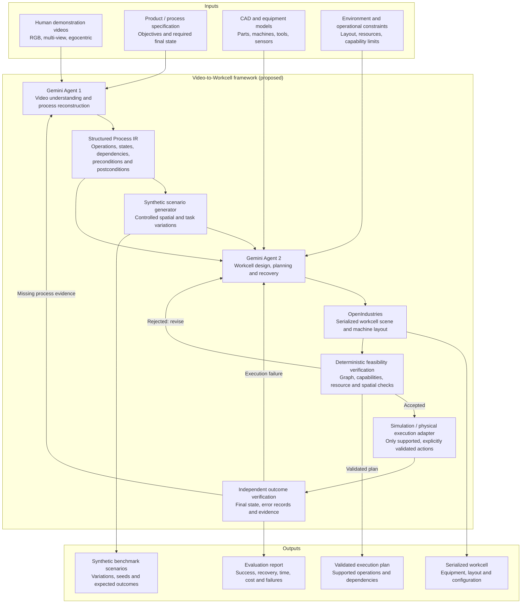

# Video-to-Workcell

### Benchmark-Grounded Multi-Agent Synthesis and Verification of Physical Processes

**Working research proposal · November 2026**

**Gemini 4 NYC Hackathon primary track: [Element 119 — Multimodal AI](docs/hackathon-element-119.md).** The project centers on extracting a structured physical process from raw human demonstration video and turning it into a proposed, verifiable workcell. **5 Sigma evaluation methods** support the evidence, but 5 Sigma is **not** the selected submission track. **Best Use of Managed Agents** is an optional bonus target, not an achieved integration.

From human demonstration videos to structured processes, configurable workcells, and verifiable execution plans.

Video-to-Workcell investigates whether specialized AI agents, explicit physical-process representations, and deterministic verification can reduce the engineering effort required to automate unfamiliar physical procedures.

**Status:** A working [IndustReal video-to-workcell example](docs/industreal-example.md): two live Gemini managed-agent interactions reconstruct sampled video evidence and author a scene rendered by native OpenIndustries code. The first run produced seven coarse steps and a ten-object conceptual workcell using original dataset geometry. Video understanding accuracy, physical feasibility, and hardware execution are not validated. The broader architecture below remains a research proposal; no benchmark scores are claimed.

## Research motivation

Recognizing a human action does not establish that a machine can reproduce it. An observed insertion, for example, may depend on orientation, tolerances, force limits, fixtures, reachability, and tool compatibility that are not directly recoverable from video.

Video-to-Workcell treats the **complete physical process and the workcell required to execute it** as the unit of investigation. The goal is to link observed behavior to operational requirements, equipment configuration, executable plans, and independently checkable outcomes.

> Can an autonomous system observe an unfamiliar physical procedure, reconstruct its operational requirements, configure an appropriate workcell, and execute the resulting process with verifiable correctness?

## Research questions

| Question | Focus |
| --- | --- |
| **RQ1 — Process reconstruction** | Recover accurate task graphs, object states, dependencies, and procedural constraints from human demonstrations. |
| **RQ2 — Automation synthesis** | Generate feasible workcell configurations and executable machine plans more reliably than direct video-to-action and fixed-sequence baselines. |
| **RQ3 — Generalization and recovery** | Improve completion under unseen configurations, environmental conditions, and operational failures through controlled synthetic variation and execution feedback. |

**Central hypothesis:** Explicit physical representations, specialized agents, and deterministic feedback provide greater reliability and adaptability than unconstrained action generation from video alone. This hypothesis remains to be tested.

## Proposed architecture

The proposed framework transforms demonstration videos and physical context into serialized workcell configurations, executable process plans, synthetic evaluation scenarios, and independently verified outcomes. These are **intended outputs**, not claims of an implemented pipeline.



### Inputs and expected outputs

| Input | Expected output |
| --- | --- |
| Human demonstration videos | Grounded operations, object states, and process dependencies |
| Product or process specification | Explicit objectives, preconditions, and required final states |
| CAD and equipment models | Serialized workcell with equipment assignments and spatial configuration |
| Environment and resource constraints | Feasibility-checked plan for supported machine operations |
| Grounded synthetic task variations | Reproducible benchmark scenarios, generation seeds, and expected outcomes |
| Simulation or physical execution observations | Outcome evidence, failure diagnoses, recovery traces, and evaluation metrics |

**Core transformation:** Human demonstration video + physical context → proposed executable workcell + verification evidence.

Generating a plausible plan or animation does not prove physical task completion. Validation must distinguish logical checks, simulated execution, and independently evidenced physical execution.

### Agent 1 — Process reconstruction

- Ground objects, actions, and state transitions in demonstration evidence.
- Represent dependencies as a partial-order task graph rather than assuming one mandatory linear sequence.
- Record preconditions, expected effects, completion predicates, and procedural anomalies.
- Identify missing engineering information and distinguish observed evidence from inferred or assumed properties.

### Agent 2 — Workcell planning

- Map required operations to available machine capabilities, tooling, sensors, and fixtures.
- Propose object placement, equipment layout, resource assignments, and operation schedules.
- Generate a plan whose operations have explicit preconditions and expected state changes.
- Revise the plan or workcell configuration in response to validation and execution feedback.

### Deterministic verification and execution feedback

Validators are intended to check graph consistency, operation support, resource conflicts, spatial constraints, and task-specific completion conditions. Checks for reachability, collision, contact, and force require appropriate geometry, engineering metadata, and validated execution models; a logical validator alone cannot establish physical feasibility.

Execution feedback should identify which conditions failed and support targeted recovery. Successful plan generation, valid simulated execution, and successful physical execution are separate outcomes.

## Process and workcell representations

The proposed intermediate representation connects:

| Representation | Intended contents |
| --- | --- |
| **Entities** | Components, tools, fixtures, machines, sensors, and their identifiers and properties. |
| **States** | Object poses, assembly relations, machine modes, and observable task conditions. |
| **Operations** | Inputs, outputs, capability requirements, preconditions, effects, and success predicates. |
| **Dependencies** | Required ordering, interchangeable operations, and shared-resource constraints. |
| **Workcell** | Equipment inventory, layout, supported operations, and operational limits. |
| **Provenance** | Video evidence, trusted source models, measured properties, uncertainty, and declared simulation assumptions. |
| **Execution records** | Observations, validation outcomes, failures, recovery actions, and final-state evidence. |

A formal, versioned schema is a planned implementation milestone. Video-derived guesses about material properties, tolerances, or forces must not silently become validated specifications.

## OpenIndustries integration

[OpenIndustries](https://github.com/Mapped-Assembly/OpenIndustries) is the proposed spatial and operational representation layer. The supplied research paper identifies scene serialization, equipment import, machine-state infrastructure, and agent interfaces as foundations for this integration.

The [current IndustReal example](docs/industreal-example.md) now uses its native
scene serialization, geometry hydration, and `createWorld` renderer. Gemini authors
the scene specification; a deterministic adapter creates the portable manifest.
This implements a visual planning integration, not an execution adapter.

Validated contact dynamics, executable process semantics, benchmark-specific verification, and the Video-to-Workcell execution adapter are **proposed extensions**, not capabilities assumed to be available today. Integration details must be confirmed against the selected OpenIndustries version during implementation.

## Benchmark grounding

| Benchmark / dataset | Intended role |
| --- | --- |
| **Assembly101** [1] | Assembly action segmentation, procedural structure, and variation in execution order. |
| **IndustReal** [2] | Procedure-step completion, ordering errors, and grounding with component geometry. |
| **CaptainCook4D** [3] | Procedural error recognition, state tracking, and recovery-oriented analysis. |
| **IMPACT** [4] | Partial-order assembly processes, component states, and anomaly recovery. |
| **LongVILBench** [5] | Long-horizon translation from demonstration video to executable robotic programs. |
| **WatchAct** [6] | Separating video-to-plan quality, reference-plan execution, and integrated task success. |
| **RoboCasa** [7] | Controlled simulated manipulation and environment variation. |
| **BEHAVIOR-1K** [8] | Complex everyday tasks and diverse physical interactions. |
| **DexBench** [9] | Characterizing geometry, force, contact, observability, deformation, and dynamics complexity. |

One IndustReal v2 recording is integrated in the current example; other entries remain intended research foundations. Data is downloaded separately rather than bundled. Dataset access, licenses, compatible tasks, and adapter requirements must be established for each experiment. References originate from the supplied working paper; the current IndustReal source and OpenIndustries implementation have been inspected for this example.

## Synthetic scenario generation

Synthetic scenarios are proposed as controlled variations of grounded task specifications. Variation axes include:

- Object configurations and initial states.
- Spatial arrangements and workcell layouts.
- Available machines, tooling, sensors, and fixtures.
- Operational constraints and resource availability.
- Declared failure conditions for recovery experiments.

Each scenario should retain explicit task objectives, source provenance, a reproducible generation seed, and independently checkable success criteria. Geometric, physical, and procedural parameters should come from trusted models, measured properties, or explicitly declared simulation assumptions.

Generated scenarios should be checked for consistency before evaluation. Synthetic success is evidence about the tested model and environment; it does not establish real-world transfer.

## Evaluation plan

### Baselines and ablations

1. **Direct video-to-action:** Generate actions without the proposed structured process/workcell pipeline.
2. **Fixed procedural baseline:** Execute a predefined procedure using a fixed configuration.
3. **Structured multi-agent system:** Reconstruct the process, configure the workcell, validate, execute, and recover.

Planned ablations should isolate the contributions of agent specialization, explicit process representations, validation feedback, synthetic variation, and workcell reconfiguration. Comparisons should use matched tasks, available information, and declared model and compute budgets.

### Metrics

| Stage | Proposed measurements |
| --- | --- |
| Process reconstruction | Operation and state accuracy; dependency and ordering correctness. |
| Planning | Executable-plan validity; constraint violations; supported-operation coverage. |
| Execution | Independently verified final-state success; completion time; failure categories. |
| Recovery | Recovery success rate; retry counts; time to recovery. |
| Engineering effort | Human interventions and time required to obtain a feasible configuration and plan. |
| Generalization | Performance on held-out tasks, configurations, equipment, and failure conditions. |

### Experimental discipline

- Use original benchmark splits and published metrics wherever compatible.
- Report derived synthetic workcell experiments separately from original benchmark results.
- Keep variants of the same source demonstration or task family within the appropriate split to prevent leakage.
- Evaluate systems on identical held-out scenarios and report seeds, budgets, denominators, and uncertainty.
- Separate failures in perception, process reconstruction, planning, execution, and verification.
- Define success predicates independently of the agents that generate plans.
- Distinguish observed demonstrations, validated simulated execution, and physical-machine execution.

See [the evaluation protocol](docs/evaluation.md) for the proposed experiment record.

## Roadmap

- [ ] Specify typed process, workcell, execution, and provenance schemas.
- [ ] Select an initial benchmark task subset and document data access and licenses.
- [ ] Implement process reconstruction and workcell planning agents.
- [ ] Implement deterministic graph, capability, resource, and state validators.
- [ ] Build and validate an OpenIndustries adapter against a pinned version.
- [ ] Establish executable task semantics and independent success predicates.
- [ ] Implement reproducible synthetic scenario generation.
- [ ] Run baselines and ablations on held-out scenarios.
- [ ] Publish configurations, execution traces, failure analysis, and measured results.
- [ ] Investigate physical transfer using appropriately validated machine interfaces.

## Repository layout

```text
video-to-workcell/
├── ui/                   # Video-first UI and local server; technical dashboard at /runs
├── scripts/              # Dataset retrieval, video pipeline, build and checks
├── integrations/         # Gemini scene specification → native OpenIndustries manifest
├── examples/             # Earlier runtime and symbolic-planning smoke tests
├── docs/                 # Research protocol and real-example provenance
├── data/                 # Downloaded benchmark data (ignored)
└── artifacts/            # Agent outputs, scenes, reports and evidence (ignored)
```

## Getting started

### Video → analysis → workcell

Requires Python 3.10+, Node.js 22+, Git, and FFmpeg/ffprobe.

```bash
git clone https://github.com/isayahc/video-to-workcell.git
cd video-to-workcell
npm install
npm run setup
cp example.env .env
# Set GEMINI_API_KEY in .env, then:
python3 ui/server.py
```

Open **http://127.0.0.1:5187** to watch the real IndustReal recording, start Gemini
analysis, and explore the agent-designed OpenIndustries scene. Click an analysis
step to seek the video and highlight linked equipment. Existing results load without
another API call. See [UI setup](ui/README.md) and [example provenance](docs/industreal-example.md).

Start with the architecture and evaluation plan above. To try the managed runtime, follow the [Gemini Managed Agents smoke-test instructions](examples/README.md). The sample requires Python 3.10+ and a Gemini API key, with no third-party dependencies. Implementation work should make assumptions, supported operations, and verification boundaries explicit.

## Limitations

Video may not reveal hidden geometry, friction, compliance, material properties, required forces, or tolerances. Planning validity depends on the fidelity of supplied metadata and execution models. Long-horizon recovery and heterogeneous machine integration remain open engineering challenges. The framework's reliability and reduction in engineering effort have not yet been demonstrated experimentally.

## References

1. Sener, F., et al. (2022). **Assembly101: A Large-Scale Multi-View Video Dataset for Understanding Procedural Activities.** CVPR, 21096–21106. [Paper](https://openaccess.thecvf.com/content/CVPR2022/html/Sener_Assembly101_A_Large-Scale_Multi-View_Video_Dataset_for_Understanding_Procedural_Activities_CVPR_2022_paper.html)
2. Schoonbeek, T. J., et al. (2024). **IndustReal: A Dataset for Procedure Step Recognition Handling Execution Errors in Egocentric Videos in an Industrial-Like Setting.** WACV, 4365–4374. [DOI](https://doi.org/10.1109/WACV57701.2024.00431)
3. Peddi, R., et al. (2024). **CaptainCook4D: A Dataset for Understanding Errors in Procedural Activities.** NeurIPS, Datasets and Benchmarks Track. [Paper](https://proceedings.nips.cc/paper_files/paper/2024/hash/f4a04396c2ed1342a5d8d05e94cb6101-Abstract-Datasets_and_Benchmarks_Track.html)
4. Wen, D., et al. (2026). **IMPACT: A Dataset for Multi-Granularity Human Procedural Action Understanding in Industrial Assembly.** arXiv:2604.10409. [Preprint](https://arxiv.org/abs/2604.10409)
5. Chen, Q., et al. (2025). **Long-Horizon Visual Imitation Learning via Plan and Code Reflection.** arXiv:2509.05368. [Preprint](https://arxiv.org/abs/2509.05368)
6. Li, B., et al. (2026). **WatchAct: A Benchmark for Behavior-Grounded Robot Manipulation.** arXiv:2606.26443. [Preprint](https://arxiv.org/abs/2606.26443)
7. Nasiriany, S., et al. (2024). **RoboCasa: Large-Scale Simulation of Everyday Tasks for Generalist Robots.** arXiv:2406.02523. [Preprint](https://arxiv.org/abs/2406.02523)
8. Li, C., et al. (2023). **BEHAVIOR-1K: A Benchmark for Embodied AI with 1,000 Everyday Activities and Realistic Simulation.** CoRL, PMLR 205, 80–93. [Paper](https://proceedings.mlr.press/v205/li23a.html)
9. RLWRLD. (2026). **DexBench: Defining the Taxonomy for Industrial Dexterity.** [Documentation](https://dexbench.org/en/)
10. Mapped-Assembly. (2026). **OpenIndustries: An Open-Source Spatial Workbench for Physical Equipment and Operational Environments.** [Repository](https://github.com/Mapped-Assembly/OpenIndustries)
